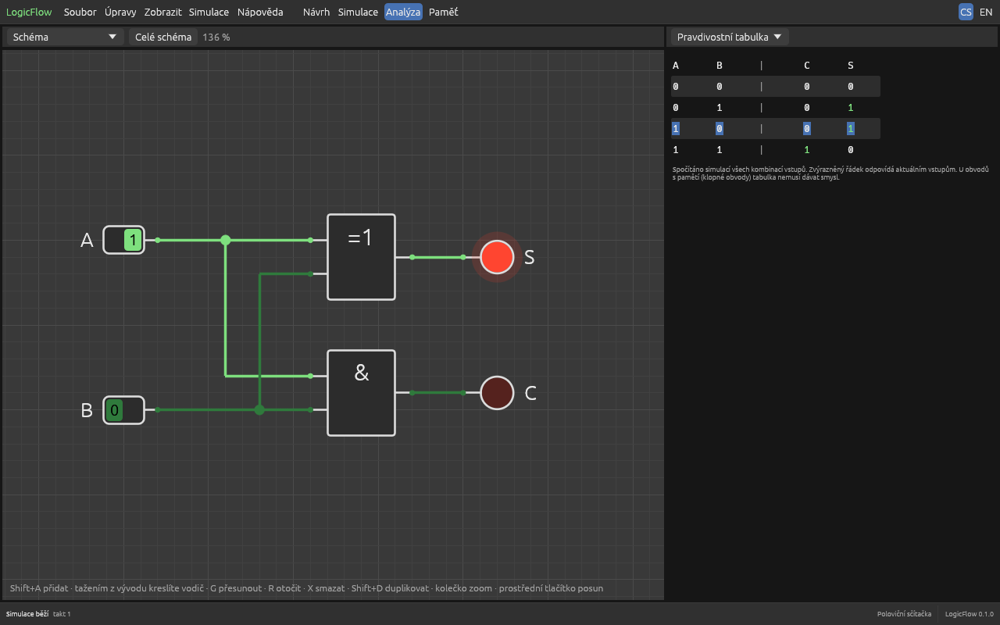

# LogicFlow

Simulátor logických obvodů pro výuku číslicové techniky. Moderní nástupce programu DigitalWorks: česky, s rozhraním ve stylu Blenderu, pro Windows, macOS, Linux i Raspberry Pi.


> **Stav:** verze 0.1 (milník M1). Kreslení vlastních obvodů z hradel, přepínačů, tlačítek a LED, simulace v reálném čase, ukládání a otevírání souborů.

## Co umí

- **Kreslení schémat** – součástky se přidávají přes Shift+A nebo z knihovny, vodiče se kreslí tažením z vývodu. Vodiče se při přesunu součástky samy přepojí.
- **Součástky** – přepínač, tlačítko, konstanty 0 a 1, hradla BUF, NOT, AND, OR, NAND, NOR, XOR, XNOR (2–8 vstupů), LED. Značky podle ČSN EN 60617.
- **Událostní simulace** se zpožděním hradel a hodnotami 0, 1, X (neurčitá, kolize) a Z (nepřipojeno). Simulátor pozná kmitající obvod a obvody s pamětí (klopný obvod z hradel) si pamatují stav i po úpravě schématu.
- **Krokování** – při pozastavené simulaci (mezerník) se šipkou vpravo provádí jeden takt; je vidět, jak signál prochází hradly.
- **Časový diagram** vstupů a výstupů a **pravdivostní tabulka** spočítaná simulací všech kombinací vstupů.
- **Soubory** `.logicflow` (čitelný JSON), vlastní prohlížeč souborů, Zpět/Znovu, vestavěné příklady.
- Okno rozdělené na **oblasti** a **pracovní plochy** (Návrh, Simulace, Analýza, Paměť) jako v Blenderu. Čeština a angličtina.

| Návrh | Analýza |
| --- | --- |
|  |  |

## Ovládání

| Klávesa / myš | Akce |
| --- | --- |
| Shift+A | nabídka Přidat součástku |
| tažení z vývodu (Ctrl+tažení odkudkoli) | nakreslit vodič |
| klik na přepínač / držení tlačítka | změna vstupu |
| klik, Shift+klik, tažení v prázdném místě | výběr, přidání do výběru, výběr obdélníkem |
| tažení součástky, G | přesun výběru |
| R | otočit o 90° (i při umisťování) |
| X, Delete | smazat výběr |
| Shift+D | duplikovat výběr |
| A / Alt+A | vybrat vše / zrušit výběr |
| kolečko, prostřední tlačítko, Home | zoom, posun, celé schéma |
| mezerník, šipka vpravo | spustit/pozastavit simulaci, jeden takt |
| Ctrl+Z, Ctrl+Shift+Z | zpět, znovu |
| Ctrl+N, Ctrl+O, Ctrl+S, Ctrl+Shift+S | nový, otevřít, uložit, uložit jako |
| Ctrl+PageUp / PageDown | předchozí / další pracovní plocha |

## Plán

| Verze | Obsah | Termín (orientačně) |
| --- | --- | --- |
| ~~0.1~~ | kreslení schémat, hradla, přepínače, LED, ukládání | hotovo |
| 0.2 | klopné obvody, generátor hodin – pilot ve třídě | 04/2027 |
| 0.3 | podobvody, čítače, registry, MUX, dekodéry, sedmisegmentovka | 05/2027 |
| 0.4 | paměti ROM, RAM, EEPROM, hex editor | 06/2027 |
| 0.5 | export do VHDL | 07–08/2027 |
| 0.6 | obvody 74xx, příručka, vzorové úlohy | 08/2027 |
| 1.0 | verze pro výuku | 09/2027 |

## Sestavení ze zdrojového kódu

Potřebujete [Rust](https://rustup.rs) 1.95 nebo novější.

```sh
git clone https://github.com/SJFidrmuc/LogicFlow
cd LogicFlow
cargo run --release
```

Soubor obvodu jde otevřít i z příkazové řádky: `logicflow muj-obvod.logicflow`. Testy: `cargo test --workspace`.

### Raspberry Pi

Podporované jsou Raspberry Pi 4 a 5 s 64bitovým Raspberry Pi OS (Debian 13 „Trixie“). Hotový program sestavuje automaticky GitHub Actions; najdete ho u každého běhu CI jako artefakt `logicflow-linux-arm64-raspberry-pi`.

## Struktura projektu

| Složka | Obsah |
| --- | --- |
| `crates/logicflow-core` | jádro bez grafického rozhraní: model obvodu, netlist, událostní simulátor, formát souboru |
| `crates/logicflow` | aplikace: okno, oblasti, editor schématu, panely, překlady |
| `.github/workflows` | automatické sestavení a testy pro 6 platforem |

## Licence

[MIT](LICENSE) © 2026 Stanislav Jan Fidrmuc
