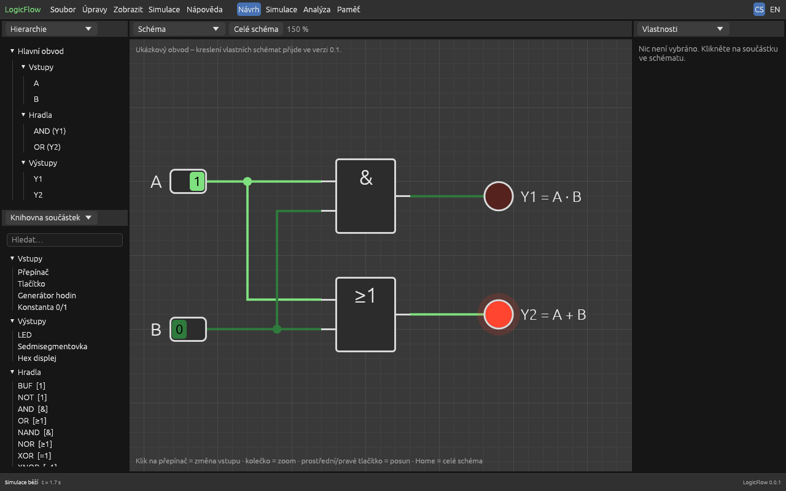
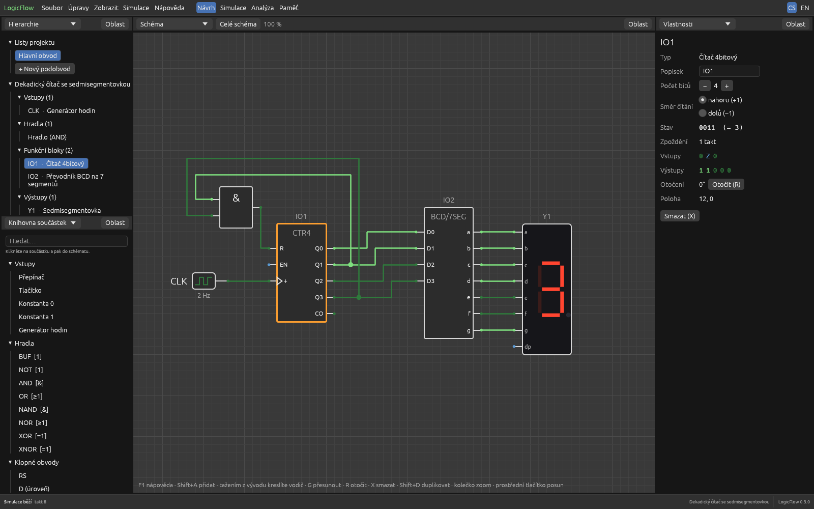
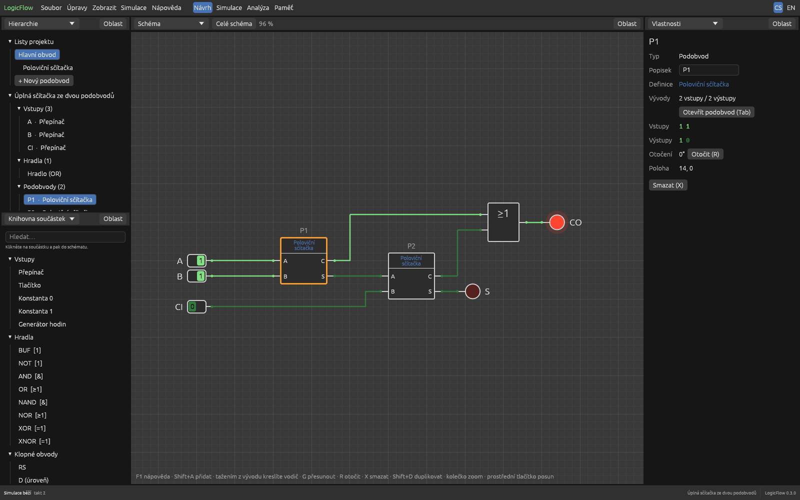

# LogicFlow

Simulátor logických obvodů pro výuku číslicové techniky. Moderní nástupce programu DigitalWorks: česky, s rozhraním ve stylu Blenderu, pro Windows, macOS, Linux i Raspberry Pi.

**Webová stránka projektu: [www.logicflow-sim.cz](https://www.logicflow-sim.cz)**


> **Stav:** verze 0.3 (milník M3). Kreslení obvodů z hradel, klopných obvodů, funkčních bloků (čítače, registry, multiplexory, dekodéry…) a podobvodů, sedmisegmentovka, simulace v reálném čase s krokováním, časový diagram, pravdivostní tabulka, evropské i americké značky, ukládání souborů a vestavěná nápověda.

## Stažení

Hotové programy jsou na stránce **[Releases → nejnovější verze](https://github.com/SJFidrmuc/LogicFlow/releases/latest)** (bez přihlášení, bez instalace).

| Systém | Soubor |
| --- | --- |
| Windows (běžné PC) | `LogicFlow-…-windows-x64.zip` |
| Windows na procesoru ARM | `LogicFlow-…-windows-arm64.zip` |
| macOS (Apple M1 a novější) | `LogicFlow-…-macos-arm64.tar.gz` |
| macOS (Intel) | `LogicFlow-…-macos-x64.tar.gz` |
| Linux (PC) | `LogicFlow-…-linux-x64.tar.gz` |
| Raspberry Pi 4 a 5 (64bitový Raspberry Pi OS) | `LogicFlow-…-raspberry-pi-arm64.tar.gz` |

- **Windows:** rozbalte ZIP a spusťte `logicflow.exe`. Pokud Windows zobrazí varování, viz [níže](#windows-hlásí-nebezpečnou-aplikaci).
- **Linux a Raspberry Pi:** `tar -xzf LogicFlow-…tar.gz`, pak `./logicflow` ve vzniklé složce.
- **macOS:** po rozbalení při prvním spuštění klikněte na `logicflow` pravým tlačítkem → Otevřít (program zatím není podepsaný).

## Co umí

- **Kreslení schémat** – součástky se přidávají přes Shift+A nebo z knihovny, vodiče se kreslí tažením z vývodu. Vodiče se při přesunu součástky samy přepojí.
- **Součástky** – přepínač, tlačítko, konstanty 0 a 1, generátor hodin (0,2–10 Hz), hradla BUF, NOT, AND, OR, NAND, NOR, XOR, XNOR (2–8 vstupů), LED, sedmisegmentovka a hex displej.
- **Značky** podle ČSN EN 60617-12 (obdélníkové, negace indikátorem negace), nebo po přepnutí v nabídce Zobrazit → Značky americké tvarové značky podle ANSI/IEEE Std 91. Volba se ukládá jako osobní nastavení, ne do souboru obvodu.
- **Klopné obvody** RS, D řízený úrovní, D, JK a T řízené náběžnou nebo sestupnou hranou, s výstupy Q a Q̄ a volitelným počátečním stavem.
- **Funkční bloky** – multiplexor, dekodér (demultiplexor), prioritní kodér, sčítačka, komparátor, převodník BCD na 7 segmentů, čítač nahoru/dolů, registr a posuvný registr s nastavitelným počtem bitů.
- **Podobvody** – libovolný obvod jde použít jako blok v jiném obvodu (vstupy jsou jeho přepínače, výstupy LED). Tab otevře podobvod a vrátí se zpět jako skupiny uzlů v Blenderu. Simulace zachovává zpoždění hradel i uvnitř podobvodů.
- **Událostní simulace** se zpožděním hradel a hodnotami 0, 1, X (neurčitá, kolize) a Z (nepřipojeno). Simulátor pozná kmitající obvod a obvody s pamětí (klopný obvod z hradel) si pamatují stav i po úpravě schématu.
- **Krokování** – při pozastavené simulaci (mezerník) se šipkou vpravo provádí jeden takt; je vidět, jak signál prochází hradly.
- **Časový diagram** vstupů a výstupů a **pravdivostní tabulka** spočítaná simulací všech kombinací vstupů.
- **Soubory** `.logicflow` (čitelný JSON), vlastní prohlížeč souborů, Zpět/Znovu, vestavěné příklady (hradla, poloviční sčítačka, klopný obvod RS z hradel, klopný obvod D s hodinami, čítač 0–7, posuvný registr, multiplexor 4:1, dekadický čítač se sedmisegmentovkou, úplná sčítačka ze dvou podobvodů).
- Okno rozdělené na **oblasti** a **pracovní plochy** (Návrh, Simulace, Analýza, Paměť) jako v Blenderu. Oblasti jde rozdělovat a zavírat (nabídka **Oblast** v záhlaví nebo pravé tlačítko na záhlaví) a v každé zvolit typ editoru.
- **Nápověda** v aplikaci (F1 nebo nabídka Nápověda) – postup pro první obvod, popis ovládání, součástek, simulace a klávesových zkratek. Nápovědu jde zobrazit i jako oblast vedle schématu.
- Čeština a angličtina.

| Návrh | Analýza |
| --- | --- |
|  |  |

| Funkční bloky | Podobvody |
| --- | --- |
|  |  |

## Ovládání

| Klávesa / myš | Akce |
| --- | --- |
| F1 | nápověda |
| Shift+A | nabídka Přidat součástku |
| tažení z vývodu (Ctrl+tažení odkudkoli) | nakreslit vodič |
| klik na přepínač / držení tlačítka | změna vstupu |
| klik, Shift+klik, tažení v prázdném místě | výběr, přidání do výběru, výběr obdélníkem |
| tažení součástky, G | přesun výběru |
| R | otočit o 90° (i při umisťování) |
| X, Delete | smazat výběr |
| Shift+D | duplikovat výběr |
| A / Alt+A | vybrat vše / zrušit výběr |
| Tab | otevřít vybraný podobvod / zpět o úroveň výš |
| kolečko, prostřední tlačítko, Home | zoom, posun, celé schéma |
| mezerník, šipka vpravo | spustit/pozastavit simulaci, jeden takt |
| Ctrl+R | restartovat simulaci (klopné obvody do počátečního stavu) |
| Ctrl+Z, Ctrl+Shift+Z | zpět, znovu |
| Ctrl+N, Ctrl+O, Ctrl+S, Ctrl+Shift+S | nový, otevřít, uložit, uložit jako |
| Ctrl+PageUp / PageDown | předchozí / další pracovní plocha |

## Windows hlásí „nebezpečnou“ aplikaci

Program zatím není digitálně podepsaný, proto ho Windows SmartScreen po stažení označí jako nerozpoznanou aplikaci. Zdrojový kód je veřejný a soubory sestavuje automaticky GitHub.

1. V okně *Systém Windows ochránil váš počítač* klikněte na **Další informace** a pak na **Přesto spustit**.
2. Aby se upozornění neopakovalo: před rozbalením klikněte na stažený ZIP pravým tlačítkem → **Vlastnosti** → zaškrtněte **Odblokovat** → OK.

Ve škole může program povolit správce sítě pro všechny počítače najednou. Podepsaná verze (SignPath Foundation nebo Microsoft Store) je v plánu.

## Plán

| Verze | Obsah | Termín (orientačně) |
| --- | --- | --- |
| ~~0.1~~ | kreslení schémat, hradla, přepínače, LED, ukládání | hotovo |
| ~~0.2~~ | klopné obvody, generátor hodin, nápověda – připraveno na pilot ve třídě | hotovo |
| ~~0.3~~ | podobvody, funkční bloky (čítače, registry, MUX, dekodéry…), sedmisegmentovka, americké značky | hotovo |
| 0.4 | sběrnice 1–64 bitů, knihovny bloků, barva LED, soubor s nastavením, jazykové balíčky, světlý motiv, export obrázku, nápověda v Markdownu i v programu | 2027 |
| 0.5 | paměti ROM, RAM, EEPROM, hex editor | 2027 |
| 0.6 | export do VHDL | 2027 |
| 0.7 | obvody 74xx, příručka, vzorové úlohy | 2027 |
| 1.0 | verze pro výuku | 09/2027 |

## Sestavení ze zdrojového kódu

Potřebujete [Rust](https://rustup.rs) 1.95 nebo novější.

```sh
git clone https://github.com/SJFidrmuc/LogicFlow
cd LogicFlow
cargo run --release
```

Soubor obvodu jde otevřít i z příkazové řádky: `logicflow muj-obvod.logicflow`. Testy: `cargo test --workspace`.

### Raspberry Pi

Podporované jsou Raspberry Pi 4 a 5 s 64bitovým Raspberry Pi OS (Debian 13 „Trixie“). Hotový program je ke stažení na stránce Releases (viz Stažení); sestavuje se v Debianu 13, aby odpovídal knihovnám Raspberry Pi OS.

### Nápověda

Nápověda se píše v Markdownu ve složce [`docs/napoveda`](docs/napoveda) (česky a anglicky) a sestavuje se nástrojem [mdBook](https://rust-lang.github.io/mdBook/). Náhled: `mdbook serve docs/napoveda/cs --open`. Jak psát a jak pořizovat snímky obrazovky, popisuje [docs/napoveda/README.md](docs/napoveda/README.md). Postup vývoje je v [CONTRIBUTING.md](CONTRIBUTING.md).

### Vydání nové verze

V GitHubu zvolte *Releases → Draft a new release*, zadejte nový tag ve tvaru `vX.Y.Z` (např. `v0.3.1`), cíl *main*, a klikněte na *Publish release*. Workflow *Vydání* pak během několika minut sestaví program pro všech šest platforem a nápovědu v HTML a soubory sám připojí k vydání. Nápověda se může zároveň zveřejnit na webu (GitHub Pages) – postup zapnutí je v `.github/workflows/release.yml`.

## Struktura projektu

| Složka | Obsah |
| --- | --- |
| `crates/logicflow-core` | jádro bez grafického rozhraní: model obvodu, netlist, událostní simulátor, formát souboru |
| `crates/logicflow` | aplikace: okno, oblasti, editor schématu, panely, překlady |
| `docs/napoveda` | nápověda v Markdownu (cs, en), obrázky a obvody pro snímky |
| `docs/screenshots` | snímky obrazovky pro README |
| `scripts` | pomocné skripty (snímky obrazovky pro nápovědu) |
| `.github/workflows` | automatické sestavení a testy pro 6 platforem, nápověda, vydání |

## Licence

[MIT](LICENSE) © 2026 Stanislav Jan Fidrmuc
