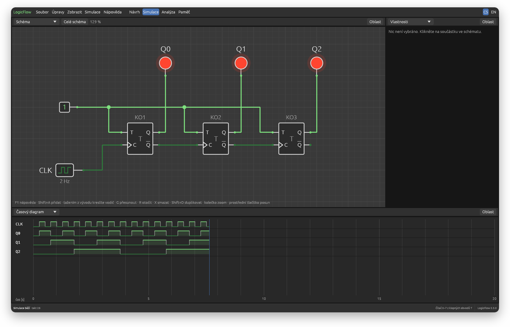
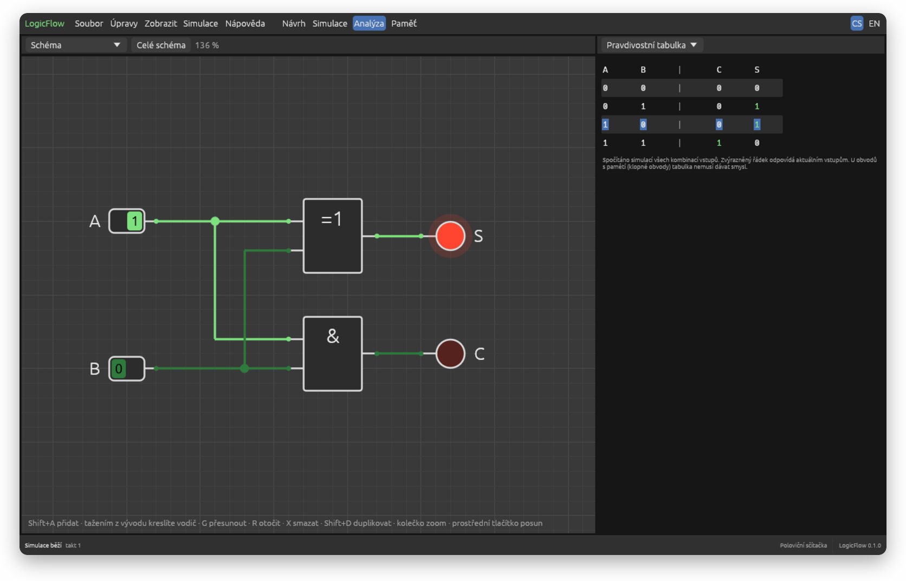

# Analýza

## Časový diagram

Časový diagram zaznamenává průběh všech přepínačů, tlačítek a LED za posledních 20 sekund. Signály jsou seřazené podle popisku, hodiny jsou vždy nahoře. Při pozastavené simulaci posune každý krok diagram o čtvrt sekundy. Nejpohodlněji ho uvidíte na pracovní ploše **Simulace**.

## Pravdivostní tabulka

Tabulka se spočítá simulací všech kombinací vstupů, nejvýše 8 vstupů (256 řádků). Vstupy jsou přepínače a tlačítka, výstupy LED (s jedním vývodem). Zvýrazněný řádek odpovídá aktuálnímu nastavení přepínačů. Najdete ji na pracovní ploše **Analýza**. Pravé tlačítko na tabulce → **Kopírovat jako text** ji zkopíruje do schránky; po vložení do Wordu nebo tabulkového procesoru vzniknou sloupce.

> **Pozor:** u obvodů s pamětí (klopné obvody, čítače) tabulka nemusí dávat smysl, protože výstup závisí i na předchozím stavu. Pro ně použijte časový diagram.

> **Tip pro výuku:** Žák nakreslí obvod podle zadání a pravdivostní tabulkou si sám ověří, že odpovídá zadané funkci.
