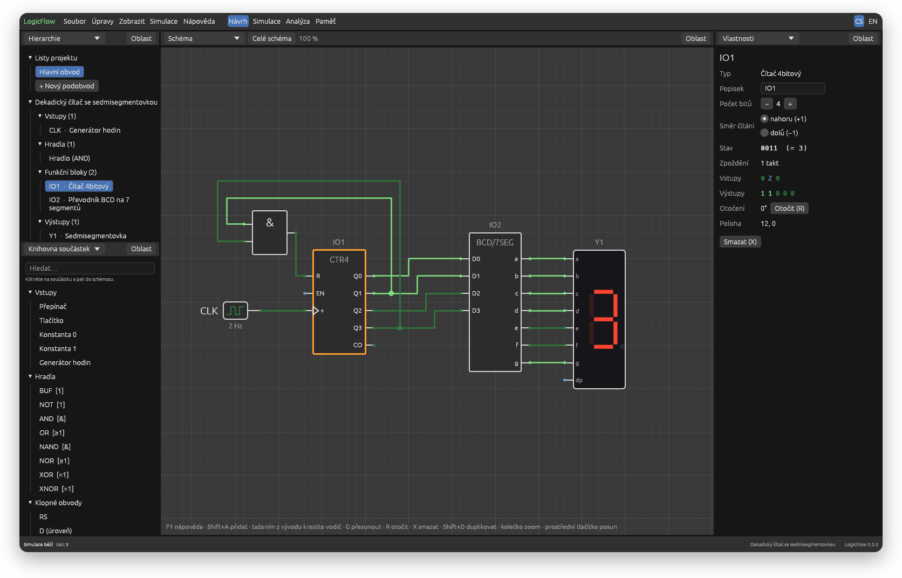

# Funkční bloky a zobrazovače

Hotové bloky najdete v **Shift+A → Funkční bloky**. Vstupy jsou vlevo, výstupy vpravo a bity jsou seřazené shora od nejnižšího (D0, Q0…). Počet bitů nebo adresových vstupů se mění ve Vlastnostech.

| Blok | Značka | Funkce |
| --- | --- | --- |
| Multiplexor | MUX | adresa S vybere jeden ze vstupů D a pošle ho na výstup Y (1–3 adresové vstupy) |
| Dekodér, demultiplexor | X/Y | výstup Y s číslem adresy A je 1, ostatní 0; při EN = 0 jsou všechny 0. S datovým signálem na EN pracuje jako demultiplexor |
| Prioritní kodér | HPRI | na výstupech A je číslo nejvyššího vstupu I, který je 1; V = 1 znamená, že je aktivní aspoň jeden vstup (4:2 nebo 8:3) |
| Sčítačka | Σ | sečte čísla A a B a přenos CI; výsledek S a přenos CO (1bitová je úplná sčítačka), 1–4 bity |
| Komparátor | COMP | porovná čísla A a B: A<B, A=B, A>B; 1–4 bity |
| Převodník BCD na 7 segmentů | BCD/7SEG | číslo 0–15 na vstupech D převede na segmenty a–g (10–15 jako A–F) |
| Čítač | CTR | při náběžné hraně C přičte (+) nebo odečte (−) jedničku; R nuluje okamžitě, EN = 0 čítání zastaví; CO = 1 při nejvyšším stavu (dolů při 0); 2–8 bitů |
| Registr | RG | při náběžné hraně C uloží vstupy D, R nuluje |
| Posuvný registr | SRG | při náběžné hraně C posune obsah o bit dál (Q0 → Q1…) a do Q0 zapíše SI |

> **Tip:** Vstupy R a EN můžete nechat nepřipojené: nepřipojený R znamená „nenulovat“ a nepřipojený EN „povoleno“. U ostatních vstupů dává nepřipojený vývod neznámou hodnotu X.

## Zobrazovače

- **Sedmisegmentovka** má vstupy a–g a desetinnou tečku dp. Každý segment svítí při 1.
- **Hex displej** ukáže číslici 0–F podle 4bitového vstupu D0–D3. Při neznámém vstupu jsou segmenty tmavě šedé.
- Ve Vlastnostech jde zvolit, na které straně má zobrazovač vývody (vlevo, vpravo, nahoře, dole). Číslice zůstane vždy rovně, na rozdíl od otočení klávesou R.

> **Tip:** Příklad Dekadický čítač se sedmisegmentovkou ukazuje čítač nulovaný hradlem AND při stavu 10 (1010). Takto vzniká čítač do libovolného čísla.
