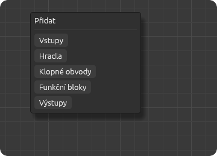
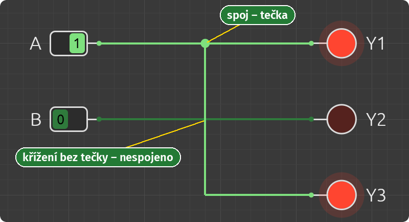
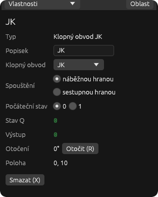

# Kreslení schématu

## Přidání součástky

- **Shift+A** nad schématem otevře nabídku Přidat rozdělenou do skupin: Vstupy, Hradla, Klopné obvody, Funkční bloky, Výstupy a Podobvody.
- Nebo klikněte na součástku v **Knihovně součástek** a pak do schématu. Pole Hledat nahoře v knihovně filtruje podle názvu.
- Při umisťování klávesa **R** otáčí o 90°, **Shift+klik** umístí další kus stejné součástky, **Esc** nebo pravé tlačítko umisťování zruší.

## Vodiče

- Vodič začíná tažením z vývodu součástky (vývod se pod myší zvýrazní kroužkem) nebo z libovolného bodu existujícího vodiče. S klávesou Ctrl jde začít kdekoli.
- Vodič se láme do pravého úhlu. Směr prvního úseku určí první pohyb myši.
- Kde konec vodiče leží na jiném vodiči, vznikne spoj a zobrazí se tečka. Vodiče, které se jen kříží (bez tečky), propojené nejsou.
- Vývod součástky se připojí jen ke konci vodiče. Vodič, který přes vývod jen prochází, se s ním nespojí.
- Při kreslení oranžový kroužek ukazuje místo, kde by se vodič napojil i jinde než na začátku a konci. Pokud má opačné zalomení méně takových míst, program ho použije sám.
- Při přesunu součástky se připojené vodiče zalomí tak, aby se nedotkly jiného spoje. Když to nejde, vodič se od vývodu odpojí: volný konec je vidět a stačí ho dotáhnout.

## Výběr a úpravy

| Akce | Co udělá |
| --- | --- |
| klik | vybrat součástku nebo vodič |
| Shift+klik | přidat do výběru nebo odebrat z výběru |
| tažení v prázdném místě | výběr obdélníkem |
| tažení součástky, G | přesun výběru (vodiče se přepojí) |
| R | otočit o 90° |
| X, Delete | smazat výběr |
| Shift+D | duplikovat výběr |
| A, Alt+A | vybrat vše, zrušit výběr |
| Ctrl+Z, Ctrl+Shift+Z | zpět, znovu |

## Pohled na schéma

- **Kolečko myši** přibližuje a oddaluje, **prostřední nebo pravé tlačítko** s tažením posouvá pohled.
- **Home** nebo tlačítko **Celé schéma** v záhlaví zobrazí celý obvod. Vedle tlačítka je vidět aktuální zvětšení v procentech.
- Dole ve schématu je řádek s nejdůležitějšími klávesami.

## Vlastnosti součástky

V oblasti **Vlastnosti** se u vybrané součástky zobrazí její typ a nastavení. Podle druhu součástky jde změnit:

- **popisek** (např. A, B, CLK, Y1); určuje i pořadí signálů v časovém diagramu a pravdivostní tabulce,
- **druh hradla** a **počet vstupů** (2–8),
- **hodnotu konstanty**, **frekvenci** generátoru hodin,
- u klopných obvodů **druh**, **spouštění** (úroveň, náběžná nebo sestupná hrana) a **počáteční stav**,
- u funkčních bloků **počet bitů** a u čítače **směr čítání**,
- u zobrazovačů **stranu vývodů**,
- **otočení**; tlačítko **Smazat** součástku odstraní.

Vlastnosti zároveň ukazují **živé hodnoty** součástky: stav, vstupy a výstupy (u čítače např. 0011 = 3) a zpoždění v taktech.

