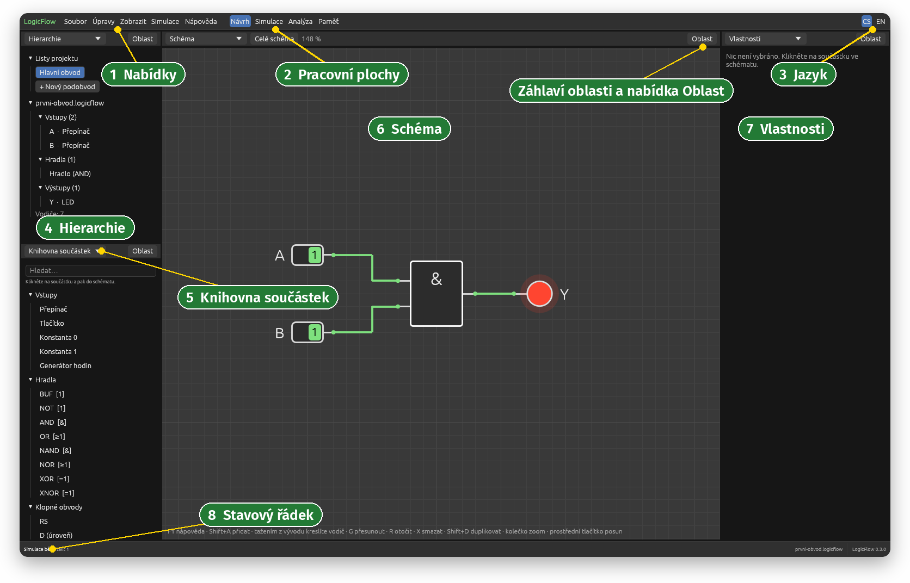

# Okno a oblasti

Okno je stejně jako v Blenderu rozdělené na oblasti. Každá oblast má nahoře záhlaví a v něm volbu typu editoru, který jde kdykoli přepnout.

## Horní lišta

- **Nabídky** Soubor, Úpravy, Zobrazit, Simulace a Nápověda. U každé položky je vpravo její klávesová zkratka; položky, které teď nejdou použít (například Zpět bez předchozí úpravy), jsou zašedlé. V nabídce Úpravy je kromě Zpět a Znovu i výběr, otočení, mazání a otevření podobvodu – totéž, co dělají klávesy nad schématem.
- **Pracovní plochy** Návrh, Simulace, Analýza a Paměť uprostřed.
- **Přepínač jazyka** CS / EN vpravo.

Dole je **stavový řádek**: ukazuje režim (úpravy nebo simulace), zda simulace běží, číslo taktu, název obvodu a verzi programu.

## Typy editorů

| Editor | K čemu slouží |
| --- | --- |
| Schéma | kreslení a simulace obvodu |
| Časový diagram | průběh vstupů a výstupů v čase |
| Vlastnosti | nastavení vybrané součástky (popisek, druh, počet vstupů, frekvence…) |
| Hierarchie | listy projektu (hlavní obvod a podobvody) a seznam součástek obvodu |
| Knihovna součástek | všechny součástky s vyhledáváním; klik na součástku a pak do schématu ji vloží |
| Pravdivostní tabulka | tabulka spočítaná simulací všech kombinací vstupů |
| Editor paměti | ukázka budoucího editoru pamětí ROM a RAM (paměti přibudou v další verzi) |
| Nápověda | tato nápověda jako oblast vedle schématu |

## Přidání a zavření oblasti

- Vpravo v záhlaví oblasti je nabídka **Oblast**. Stejnou nabídku otevře i klik pravým tlačítkem na záhlaví.
- **Rozdělit vedle sebe** a **Rozdělit pod sebe** vytvoří novou oblast se stejným editorem, v ní pak přepněte typ.
- **Zavřít oblast** ji odstraní. Poslední oblast zavřít nejde.
- Velikost oblastí změníte tažením hranice mezi nimi.
- Oblast přesunete tažením za prázdné místo v záhlaví. Když ji pustíte doprostřed jiné oblasti, vzniknou záložky.

## Pracovní plochy

Záložky Návrh, Simulace, Analýza a Paměť jsou pracovní plochy. Každá má vlastní rozložení oblastí, ale všechny pracují se stejným obvodem:

- **Návrh** – schéma, hierarchie, knihovna součástek a vlastnosti,
- **Simulace** – schéma s časovým diagramem pod ním; přepnutím na tuto plochu se simulace spustí a schéma se zamkne, přepnutím jinam (nebo Esc) se zastaví,
- **Analýza** – schéma s pravdivostní tabulkou,
- **Paměť** – připraveno pro paměti v další verzi.

Plochy se přepínají i klávesami Ctrl+PageUp a Ctrl+PageDown. **Zobrazit → Obnovit rozložení oblastí** vrátí výchozí stav. Rozložení oblastí a velikost okna si program pamatuje i po zavření.

> **Tip:** Každý editor schématu má vlastní pohled. V jedné oblasti můžete mít celý obvod a ve druhé přiblížený detail.
