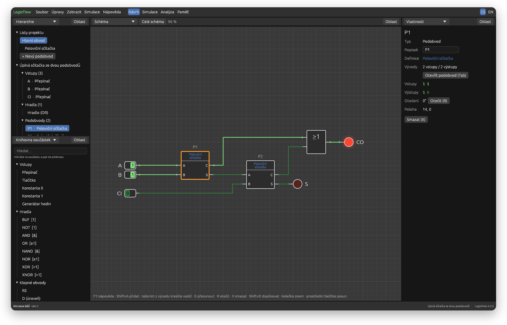

# Podobvody

Podobvod je samostatný obvod, který vložíte do jiného jako jednu součástku. Například poloviční sčítačku použijete dvakrát v úplné sčítačce. Vstupy podobvodu jsou jeho přepínače a tlačítka, výstupy jeho LED. Pořadí vývodů na značce určují jejich popisky (A, B, C…).

## Postup

1. V oblasti **Hierarchie** klikněte na **+ Nový podobvod**. Otevře se prázdný list a v záhlaví schématu uvidíte cestu *Hlavní obvod / Podobvod 1*.
2. Nakreslete obvod se vstupy (přepínači) a výstupy (LED) a vyzkoušejte ho, třeba i s pravdivostní tabulkou.
3. V Hierarchii ho pojmenujte v poli **Název**.
4. Klávesou **Tab** se vrátíte do hlavního obvodu. Podobvod pak vložíte z **Shift+A → Podobvody** nebo z Knihovny součástek.

## Práce s podobvody

- **Tab** nad vybranou značkou podobvodu ho otevře, další Tab vrátí zpět (jako skupiny uzlů v Blenderu). Mezi listy jde přecházet i kliknutím v Hierarchii.
- Úpravy podobvodu se projeví ve všech jeho instancích. Když přidáte vstup nebo výstup, značka dostane další vývod.
- Podobvod může obsahovat další podobvody, ale ne sám sebe.
- Použitý podobvod nejde smazat. Nejdřív odstraňte jeho instance.
- Hodiny je potřeba přivést zvenku přes vstup podobvodu. Generátor hodin uvnitř podobvodu stojí.
- Simulace zachovává zpoždění hradel i uvnitř podobvodů a každá instance má vlastní stav (např. vlastní klopné obvody).
- Celý projekt včetně všech podobvodů se ukládá do jednoho souboru.

> **Hotový příklad:** Soubor → Příklady → Úplná sčítačka ze dvou podobvodů.
