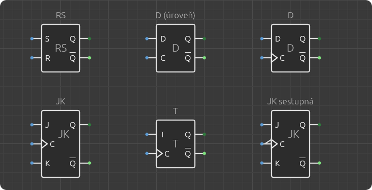

# Sekvenční obvody

Sekvenční obvody si pamatují stav. Jejich výstup závisí nejen na vstupech, ale i na tom, co se dělo předtím. LogicFlow má hotové klopné obvody (Shift+A → Klopné obvody) a generátor hodin (Shift+A → Vstupy).

## Klopné obvody

| Obvod | Chování |
| --- | --- |
| RS | S = 1 nastaví Q = 1, R = 1 vynuluje Q = 0, S = R = 0 drží stav, S = R = 1 je zakázaný stav (X) |
| D řízený úrovní | dokud je C = 1, výstup Q sleduje vstup D; při C = 0 drží |
| D | při hraně hodin uloží hodnotu D |
| JK | při hraně: J = 1 nastaví, K = 1 vynuluje, J = K = 1 překlopí, J = K = 0 drží |
| T | při hraně: T = 1 překlopí, T = 0 drží |

Každý klopný obvod má výstupy Q a Q̄ (negovaný). Vstup řízený hranou je ve značce označený trojúhelníkem uvnitř obrysu. Indikátor negace na vývodu před ním znamená sestupnou hranu. Ve Vlastnostech jde zvolit druh obvodu, spouštění náběžnou nebo sestupnou hranou a počáteční stav (0 nebo 1).

## Generátor hodin

- Vytváří pravidelný obdélníkový signál. Frekvence se nastavuje ve Vlastnostech (0,2 až 10 Hz).
- Hodiny běží jen v režimu simulace (F5), v režimu úprav stojí. Při pozastavení se s každým krokem (šipka vpravo) posunou o čtvrt sekundy.
- V časovém diagramu jsou hodiny vždy nahoře, takže je vidět, při které hraně se výstupy mění.

## Restart simulace

**Simulace → Restartovat simulaci** (Ctrl+R) vrátí všechny klopné obvody do počátečního stavu, hodiny na 0 a vymaže časový diagram.

> **Tip:** Vyzkoušejte příklady Čítač 0–7 z klopných obvodů T a Posuvný registr 4 bity. V čítači každý další stupeň řídí výstup Q̄ předchozího, tak vzniká asynchronní čítač nahoru.
