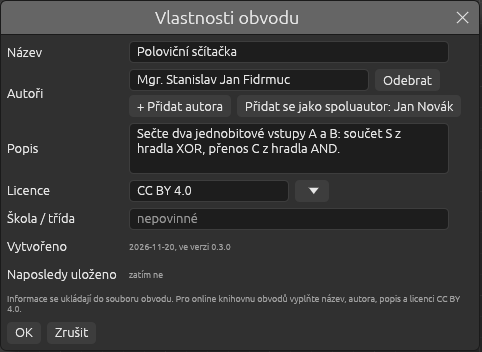

# Soubory, příklady a nastavení

## Ukládání a otevírání

- **Ctrl+S** uloží obvod, **Ctrl+Shift+S** uloží pod jiným názvem, **Ctrl+O** otevře, **Ctrl+N** vytvoří nový.
- Obvody se ukládají do souborů **.logicflow** i se všemi podobvody. Je to čitelný text (JSON), takže se dá odevzdat, poslat e-mailem nebo uložit do Gitu. Stejný soubor otevřete ve Windows, na Macu, v Linuxu i na Raspberry Pi.
- Okno pro výběr souboru má tlačítka pro domovskou složku a Dokumenty, do řádku s cestou jde napsat libovolnou složku. Tlačítko **+ Nová složka** založí podsložku (třeba pro třídu nebo úlohu) a rovnou do ní přejde.
- Před zavřením programu nebo otevřením jiného obvodu se program zeptá na neuložené změny.
- Soubor jde otevřít i z příkazové řádky: `logicflow obvod.logicflow`
- **Soubor → Importovat jako podobvod…** (**Ctrl+I**) vloží uložený obvod do otevřeného projektu jako podobvod (viz [Podobvody](podobvody.md)).

## Kterou verzí programu soubor otevřete

Soubor `.logicflow` otevře každá verze LogicFlow, která zná **všechny součástky** v něm použité. Novější verze otevře soubor z libovolné starší verze.

| Obvod obsahuje | Otevře LogicFlow |
| --- | --- |
| hradla, přepínače, tlačítka, konstanty, LED | od 0.1 |
| klopné obvody, generátor hodin | od 0.2 |
| funkční bloky, sedmisegmentovku, hex displej, podobvody | od 0.3 |
| napájení VCC a zem GND, LED se dvěma vývody | od 0.4 |
| vlastnosti obvodu (autor, licence…) | otevře i starší verze, ale před 0.4 je při uložení zahodí |
| barvu LED | otevře i starší verze, LED ale ukážou červeně |

Starší verze soubor s neznámou součástkou **odmítne otevřít** s chybovou hláškou – nic se nepoškodí. Pokud obvod odevzdáváte nebo posíláte někomu se starší verzí, použijte jen součástky, které jeho verze zná. Knihovny prvků (`.lflib`) umí program od verze 0.4.

Přesný popis obou formátů – pro autory skriptů a dalších programů – je v repozitáři projektu ve složce [docs/formaty](https://github.com/SJFidrmuc/LogicFlow/tree/main/docs/formaty).

## Vlastnosti obvodu – autor a licence

Okno **Soubor → Vlastnosti obvodu…** (nebo kliknutí na informace nahoře v panelu Hierarchie) ukládá do souboru obvodu informace o něm:

- **Název**, **autoři**, **popis** (co obvod dělá, k čemu slouží), **licence** a nepovinně **škola / třída**.
- **Nový obvod** (Ctrl+N) dostane autora a licenci z nastavení (viz níže) a dnešní datum vytvoření. Při každém uložení se zapíše datum poslední úpravy.
- U obvodu někoho jiného tlačítko **Přidat se jako spoluautor** připíše vaše jméno na konec seznamu – původní autor zůstává první.
- Změny se projeví tlačítkem **OK**, **Zrušit** je zahodí. Obvod je pak potřeba uložit.
- Název, autoři a licence jsou vidět nahoře v panelu **Hierarchie** (popis po najetí myší) a v okně pro otevření souboru po vybrání souboru – ještě než ho otevřete.
- Do **online knihovny obvodů** se přijímají obvody s vyplněným názvem, autorem, popisem a licencí **CC BY 4.0**.

> **Tip:** Verze 0.3 informace o obvodu nezná – když v ní soubor uložíte, informace se ztratí.

## Příklady

V nabídce **Soubor → Příklady** je 9 hotových obvodů. Příklad se otevře jako nový obvod, takže ho můžete libovolně upravit a uložit pod vlastním názvem.

| Příklad | Co ukazuje |
| --- | --- |
| Hradla AND a OR | základní hradla a pravdivostní tabulku |
| Poloviční sčítačka | kombinační obvod z hradel XOR a AND |
| Klopný obvod RS z hradel NOR | paměť složenou z hradel a počáteční stav X |
| Klopný obvod D s hodinami | uložení hodnoty při hraně hodin |
| Čítač 0–7 z klopných obvodů T | asynchronní čítač a časový diagram |
| Posuvný registr 4 bity | posun dat řetězcem klopných obvodů D |
| Multiplexor 4:1 | funkční blok MUX |
| Dekadický čítač se sedmisegmentovkou | čítač, převodník BCD/7SEG a nulování při stavu 10 |
| Úplná sčítačka ze dvou podobvodů | podobvody a jejich vnoření |

## Jazyk a značky

- **Jazyk** přepnete tlačítky CS / EN vpravo nahoře nebo v nabídce **Zobrazit → Jazyk**. Změna platí hned, bez restartu.
- **Styl značek** (evropské podle ČSN EN 60617-12, nebo americké ANSI/IEEE) zvolíte v **Zobrazit → Značky**.
- Při prvním spuštění se obojí nastaví podle systému: čeština v českém a slovenském prostředí, jinak angličtina; americké značky v americkém prostředí. Vaši ruční volbu si program pamatuje v souboru s nastavením.

## Nastavení

Okno **Úpravy → Nastavení…** sdružuje osobní nastavení. Program si ho pamatuje v souboru s nastavením.

- **Obecné:** jazyk, styl značek a povolení úprav za běhu simulace (stejné volby jako v nabídkách).
- **Autor a licence:** vaše jméno a výchozí licence (CC BY 4.0). Použijí se u prvků exportovaných do knihovny a v informacích o obvodu.
- **Knihovny:** složka osobních knihoven (výchozí `Dokumenty/LogicFlow/Knihovny`) a **sdílené složky** – složky na síti, na OneDrivu nebo kroužku, jejichž knihovny uvidíte v Knihovně součástek. U sdílené složky volba **jen pro čtení** znamená, že do ní program nic nezapíše. Nedostupná složka (odpojená síť) se v knihovně ukáže jako upozornění.
- **Soubor s nastavením** je čitelný text `logicflow.toml`: ve Windows `%APPDATA%\LogicFlow` (s cestovním profilem se přenáší na další počítače), v macOS `~/Library/Application Support/LogicFlow`, v Linuxu a na Raspberry Pi `~/.config/logicflow`. Tlačítko **Otevřít složku s nastavením** ho ukáže ve správci souborů.
- Soubor jde upravit i ručně. Když ho program nedokáže přečíst, odloží ho jako `logicflow.toml.bak` a použije výchozí nastavení.
- **Obnovit výchozí nastavení…** (s potvrzením) vrátí jazyk a značky podle systému a smaže jméno autora, licenci i složky knihoven.

## Nabídka Nápověda

- **Nápověda** (F1) otevře tuto nápovědu v programu.
- **Webová stránka projektu** otevře www.logicflow-sim.cz.
- **O aplikaci** ukazuje verzi programu, licenci a odkazy na web a zdrojový kód. Verzi uvádějte při hlášení chyby.
