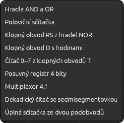

# Soubory, příklady a nastavení

## Ukládání a otevírání

- **Ctrl+S** uloží obvod, **Ctrl+Shift+S** uloží pod jiným názvem, **Ctrl+O** otevře, **Ctrl+N** vytvoří nový.
- Obvody se ukládají do souborů **.logicflow** i se všemi podobvody. Je to čitelný text (JSON), takže se dá odevzdat, poslat e-mailem nebo uložit do Gitu. Stejný soubor otevřete ve Windows, na Macu, v Linuxu i na Raspberry Pi.
- Okno pro výběr souboru má tlačítka pro domovskou složku a Dokumenty, do řádku s cestou jde napsat libovolnou složku. Tlačítko **+ Nová složka** založí podsložku (třeba pro třídu nebo úlohu) a rovnou do ní přejde.
- Před zavřením programu nebo otevřením jiného obvodu se program zeptá na neuložené změny.
- Soubor jde otevřít i z příkazové řádky: `logicflow obvod.logicflow`

## Příklady

V nabídce **Soubor → Příklady** je 9 hotových obvodů. Příklad se otevře jako nový obvod, takže ho můžete libovolně upravit a uložit pod vlastním názvem.

| Příklad | Co ukazuje |
| --- | --- |
| Hradla AND a OR | základní hradla a pravdivostní tabulku |
| Poloviční sčítačka | kombinační obvod z hradel XOR a AND |
| Klopný obvod RS z hradel NOR | paměť složenou z hradel a počáteční stav X |
| Klopný obvod D s hodinami | uložení hodnoty při hraně hodin |
| Čítač 0–7 z klopných obvodů T | asynchronní čítač a časový diagram |
| Posuvný registr 4 bity | posun dat řetězcem klopných obvodů D |
| Multiplexor 4:1 | funkční blok MUX |
| Dekadický čítač se sedmisegmentovkou | čítač, převodník BCD/7SEG a nulování při stavu 10 |
| Úplná sčítačka ze dvou podobvodů | podobvody a jejich vnoření |

Další hotové obvody od učitelů a žáků najdete v **[Knihovně obvodů LogicFlow](https://github.com/SJFidrmuc/LogicFlow-obvody/blob/main/KATALOG.md)**. Obvody jsou pod licencí CC BY 4.0 a do knihovny můžete přidat i vlastní.

## Jazyk a značky

- **Jazyk** přepnete tlačítky CS / EN vpravo nahoře nebo v nabídce **Zobrazit → Jazyk**. Změna platí hned, bez restartu.
- **Styl značek** (evropské podle ČSN EN 60617-12, nebo americké ANSI/IEEE) zvolíte v **Zobrazit → Značky**.
- Při prvním spuštění se obojí nastaví podle systému: čeština v českém a slovenském prostředí, jinak angličtina; americké značky v americkém prostředí. Vaši ruční volbu si program pamatuje.

## Nabídka Nápověda

- **Nápověda** (F1) otevře tuto nápovědu v programu.
- **Webová stránka projektu** otevře www.logicflow-sim.cz.
- **O aplikaci** ukazuje verzi programu, licenci a odkazy na web a zdrojový kód. Verzi uvádějte při hlášení chyby.
