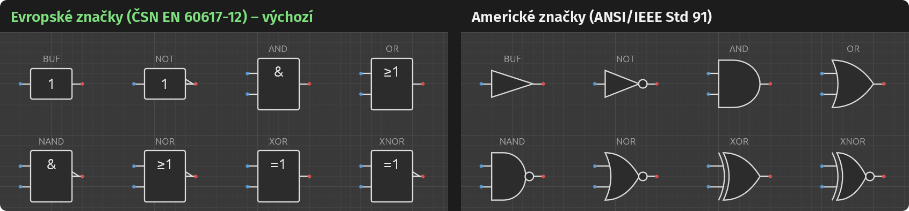

# Součástky

Součástky jsou v nabídce Shift+A i v Knihovně součástek rozdělené do skupin. Tato kapitola popisuje vstupy, hradla a výstupy. Klopné obvody a funkční bloky mají vlastní kapitoly.

| Součástka | Značka | Funkce |
| --- | --- | --- |
| Přepínač | čtvereček s 0 nebo 1 | vstup, kliknutím se přepíná mezi 0 a 1 |
| Tlačítko | – | vstup, dává 1 jen po dobu stisku |
| Konstanta 0, Konstanta 1 | – | pevná logická hodnota |
| Generátor hodin | obdélníkový průběh | pravidelný hodinový signál 0,2–10 Hz (viz [Sekvenční obvody](sekvencni-obvody.md)) |
| BUF | [1] | opakovač (budič) |
| NOT | [1] s indikátorem negace | invertor |
| AND | [&] | logický součin – 1, když jsou všechny vstupy 1 |
| OR | [≥1] | logický součet – 1, když je aspoň jeden vstup 1 |
| NAND, NOR | [&], [≥1] s indikátorem negace | negovaný součin, negovaný součet |
| XOR | [=1] | nonekvivalence – 1 při lichém počtu jedniček |
| XNOR | [=1] s indikátorem negace | ekvivalence – negovaný XOR |
| LED | kroužek | výstup, svítí při 1; při X nebo Z ukáže písmeno |

Hradla mají 2 až 8 vstupů, počet se nastavuje ve Vlastnostech. Sedmisegmentovka a hex displej jsou popsané v kapitole [Funkční bloky a zobrazovače](funkcni-bloky.md).

## Značky podle normy

Značky hradel odpovídají normě ČSN EN 60617-12 (obdélníkové značky se symbolem &, ≥1, =1, 1). Negace se značí **indikátorem negace**, malým pravoúhlým trojúhelníkem na vývodu.

## Americké značky

V nabídce **Zobrazit → Značky** jde přepnout na americké tvarové značky podle ANSI/IEEE Std 91: AND jako „D“, OR jako štít, negace kroužkem. Volba platí jen pro váš počítač a do souboru obvodu se neukládá. Obvod otevřený jinde se zobrazí podle tamního nastavení.

> **Připravuje se:** paměti ROM, RAM a EEPROM a obvody řady 74xx. V Knihovně součástek jsou už vidět jako připravované položky.
