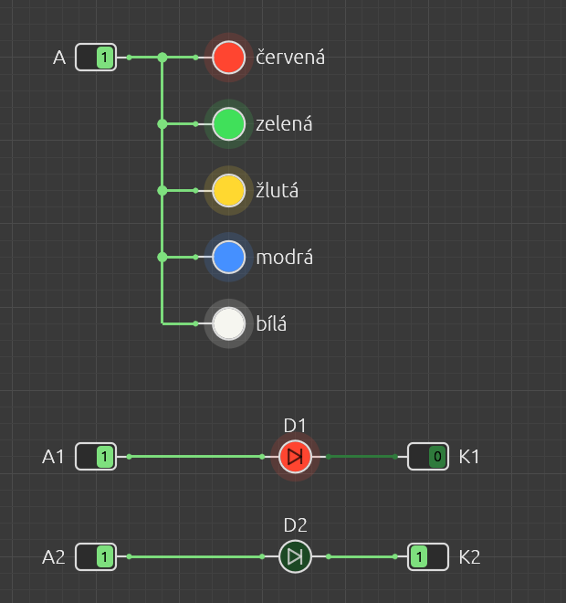

# Součástky

Součástky jsou v nabídce Shift+A i v Knihovně součástek rozdělené do skupin. Tato kapitola popisuje vstupy, hradla a výstupy. Klopné obvody a funkční bloky mají vlastní kapitoly.

| Součástka | Značka | Funkce |
| --- | --- | --- |
| Přepínač | čtvereček s 0 nebo 1 | vstup 0 nebo 1; v simulaci se přepíná kliknutím, v režimu úprav dvojklikem |
| Tlačítko | – | vstup, dává 1 jen po dobu stisku; v režimu úprav se stiskne druhým stiskem dvojkliku |
| Konstanta 0, Konstanta 1 | – | pevná logická hodnota |
| Napájení VCC | čára s příčkou a nápisem VCC | logická 1 se značkou napájení |
| Zem GND | značka země (tři zkracující se čáry) | logická 0 se značkou země |
| Generátor hodin | obdélníkový průběh | pravidelný hodinový signál 0,1–100 Hz (viz [Sekvenční obvody](sekvencni-obvody.md)) |
| BUF | [1] | opakovač (budič) |
| NOT | [1] s indikátorem negace | invertor |
| AND | [&] | logický součin – 1, když jsou všechny vstupy 1 |
| OR | [≥1] | logický součet – 1, když je aspoň jeden vstup 1 |
| NAND, NOR | [&], [≥1] s indikátorem negace | negovaný součin, negovaný součet |
| XOR | [=1] | nonekvivalence – 1 při lichém počtu jedniček |
| XNOR | [=1] s indikátorem negace | ekvivalence – negovaný XOR |
| LED | kroužek | výstup, svítí při 1; při X nebo Z ukáže písmeno |
| LED (anoda, katoda) | kroužek se značkou diody | svítí při A = 1 a K = 0 (viz níže) |

## Napájení VCC a GND

Značky **VCC** a **GND** dávají stejně jako konstanty pevnou hodnotu 1 a 0, ale vypadají jako napájení ve schématech z elektrotechniky. Každou značku stačí připojit k vývodu, který ji potřebuje; napájecí vodiče se přes celé schéma tahat nemusí. Značky nemají automatický popisek a otáčejí se klávesou R jako ostatní součástky.

Když se síť spojí zároveň s VCC (nebo Konstantou 1) a s GND (nebo Konstantou 0), vznikne **zkrat napájení**. Hodnota sítě je X, vodiče sítě jsou podbarvené červeně a schéma i stavový řádek ukážou hlášku „Zkrat napájení“. Hláška se objeví i tehdy, když je zkrat uvnitř podobvodu.

## Barva LED a LED se dvěma vývody

Ve Vlastnostech nebo v kontextové nabídce (pravé tlačítko → **Barva**) zvolíte barvu LED: červená, zelená, žlutá, modrá nebo bílá. Barva je jen vzhled – simulaci nemění. Hodí se třeba pro semafor nebo pro odlišení výstupů. Zhasnutá LED má tmavý odstín své barvy, takže barva je poznat i tehdy, když nesvítí.

Volba **Vývody** přepíná mezi LED s jedním vývodem (vstup, jako dosud) a **LED se dvěma vývody – anodou A** (vlevo) **a katodou K** (vpravo). Taková LED svítí jen při A = 1 a K = 0, tedy když jí „teče proud“ od anody ke katodě – stejně jako skutečná dioda. Při X nebo Z na kterémkoli vývodu nesvítí. Najdete ji i přímo v nabídce Shift+A → Výstupy → **LED (anoda, katoda)**. Hodí se pro maticová zapojení, kde se LED rozsvítí kombinací řádku a sloupce.

LED se dvěma vývody **není výstupem obvodu**: nepočítá se do pravdivostní tabulky ani do vývodů podobvodu. Do časového diagramu ji přidat jde – ukazuje, zda svítí. Soubor s LED se dvěma vývody otevře LogicFlow od verze 0.4; barvu starší verze nezobrazí (LED je červená).

Hradla mají 2 až 8 vstupů, počet se nastavuje ve Vlastnostech. Sedmisegmentovka a hex displej jsou popsané v kapitole [Funkční bloky a zobrazovače](funkcni-bloky.md).

## Značky podle normy

Značky hradel odpovídají normě ČSN EN 60617-12 (obdélníkové značky se symbolem &, ≥1, =1, 1). Negace se značí **indikátorem negace**, malým pravoúhlým trojúhelníkem na vývodu.

## Americké značky

V nabídce **Zobrazit → Značky** jde přepnout na americké tvarové značky podle ANSI/IEEE Std 91: AND jako „D“, OR jako štít, negace kroužkem. Volba platí jen pro váš počítač a do souboru obvodu se neukládá. Obvod otevřený jinde se zobrazí podle tamního nastavení.

> **Připravuje se:** paměti ROM, RAM a EEPROM a obvody řady 74xx. V Knihovně součástek jsou už vidět jako připravované položky.
