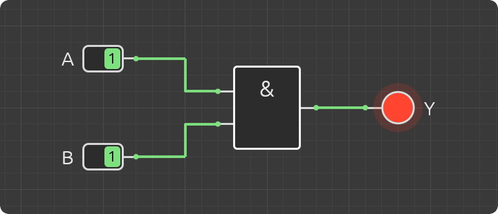

# Začínáme

LogicFlow je simulátor logických obvodů pro výuku číslicové techniky. Obvod nakreslíte ze součástek a vodičů a hned vidíte, jak pracuje: vodiče mění barvu podle logické hodnoty a LED svítí.

## Spuštění

Program se neinstaluje. Stáhněte balíček pro svůj systém ze stránky [Stáhnout](https://www.logicflow-sim.cz), rozbalte ho a spusťte `logicflow` (ve Windows `logicflow.exe`). Při prvním spuštění se jazyk a styl značek nastaví podle systému, obojí jde změnit v nabídce Zobrazit.

## První obvod za minutu

Nakreslíme hradlo AND se dvěma přepínači a LED. LED se rozsvítí jen tehdy, když jsou zapnuté oba přepínače.

1. **Soubor → Nový** (Ctrl+N) otevře prázdné schéma.
2. Najeďte myší do schématu a stiskněte **Shift+A**. Vyberte **Přepínač** a klikněte do schématu. Totéž ještě jednou, vzniknou vstupy A a B.
3. **Shift+A → AND [&]** a umístěte hradlo vpravo od přepínačů. Pak **Shift+A → LED** a umístěte ji vpravo od hradla.
4. Najeďte na výstup přepínače A (bod u pravé strany se zvýrazní kroužkem), stiskněte levé tlačítko a táhněte ke vstupu hradla. Po puštění vznikne vodič. Stejně propojte B se druhým vstupem a výstup hradla s LED.
5. Klikejte na přepínače. Vodič s logickou 1 svítí světle zeleně a LED se rozsvítí jen tehdy, když jsou oba vstupy 1.
6. Obvod uložte klávesami **Ctrl+S**.

## Co dál

- Přepněte na pracovní plochu **Analýza** a prohlédněte si pravdivostní tabulku, kterou program spočítal.
- Otevřete hotový obvod v nabídce **Soubor → Příklady**. Klopný obvod RS z hradel NOR je dobrá ukázka toho, jak si obvod pamatuje stav.
- Stiskněte **F1**. Nápověda se otevře v programu, jde ji zobrazit i jako oblast vedle schématu.
